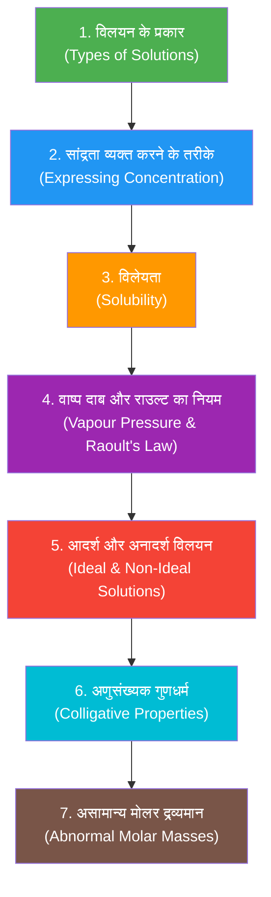
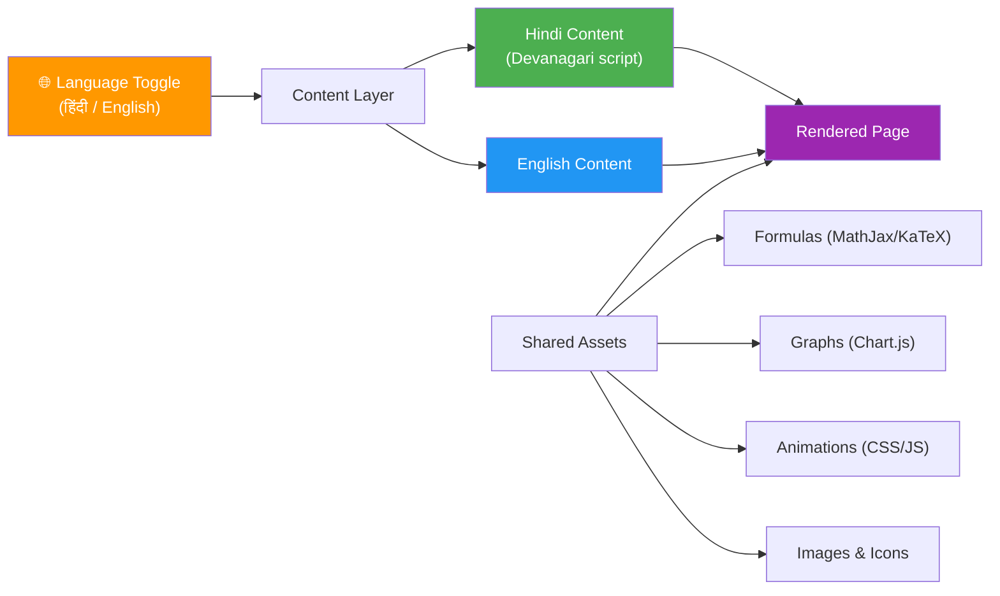

# 🧪 विलयन (Solutions) — Interactive Tutorial Website Proposal

## Chapter: Solutions (विलयन) | NCERT Class 12 Chemistry

---

## 📚 Topic Organization (Dependency-Based)

The topics are ordered so each one builds on the previous — a student can follow them linearly without confusion.



---

## 📖 Detailed Topic Breakdown & Interactive Elements

### 1. विलयन के प्रकार (Types of Solutions)
**Concepts:**
- विलयन, विलेय, विलायक की परिभाषा (Solution, Solute, Solvent)
- 9 प्रकार के विलयन (ठोस-ठोस, ठोस-द्रव, गैस-द्रव, आदि)
- संतृप्त, असंतृप्त, अतिसंतृप्त विलयन

**🎮 Interactive Elements:**
| Element | Description |
|---------|-------------|
| **Drag-and-Drop Matrix** | Students drag real-life examples (soda, alloy, air, seawater) into a 3×3 grid of solution types |
| **Animated Dissolving** | CSS/JS animation showing NaCl dissolving in water at molecular level |
| **Daily Life Carousel** | Swipeable cards showing solutions from everyday life with Hindi labels |

---

### 2. सांद्रता व्यक्त करने के तरीके (Expressing Concentration)
**Concepts:**
- द्रव्यमान प्रतिशत, आयतन प्रतिशत (Mass %, Volume %)
- मोल भिन्न (Mole Fraction)
- मोलरता, मोललता, नॉर्मलता (Molarity, Molality, Normality)
- ppm (भाग प्रति मिलियन)

**🎮 Interactive Elements:**
| Element | Description |
|---------|-------------|
| **Live Calculator** | Input mass/volume/moles → instantly see all concentration units calculated |
| **Unit Converter Widget** | Convert between Molarity ↔ Molality ↔ Mole Fraction with step-by-step solution |
| **Interactive Formula Cards** | Click a formula → see animated derivation with color-coded variables |
| **Practice Generator** | Random numericals with step-by-step hint system |

---

### 3. विलेयता (Solubility)
**Concepts:**
- ठोसों की द्रवों में विलेयता (Solubility of solids in liquids)
- गैसों की द्रवों में विलेयता (Solubility of gases in liquids)
- हेनरी का नियम (Henry's Law)
- ताप और दाब का प्रभाव (Effect of temperature and pressure)

**🎮 Interactive Elements:**
| Element | Description |
|---------|-------------|
| **Temperature Slider Graph** | Drag temperature slider → see solubility curve change in real-time for different salts (KNO₃, NaCl, Ce₂(SO₄)₃) |
| **Henry's Law Simulator** | Adjust pressure slider → see gas bubbles dissolve/release in an animated bottle (like opening a soda) |
| **Solubility Curve Plotter** | Interactive chart where students can plot solubility data points |
| **Soda Bottle Animation** | Opening a cold vs warm soda → visual explanation of gas solubility |

---

### 4. वाष्प दाब और राउल्ट का नियम (Vapour Pressure & Raoult's Law)
**Concepts:**
- शुद्ध द्रव का वाष्प दाब (Vapour pressure of pure liquids)
- अवाष्पशील विलेय का प्रभाव (Effect of non-volatile solute)
- राउल्ट का नियम — विलेय अवाष्पशील (Raoult's Law for non-volatile solute)
- राउल्ट का नियम — वाष्पशील द्रवों के विलयन (Raoult's Law for volatile liquids)

**🎮 Interactive Elements:**
| Element | Description |
|---------|-------------|
| **Raoult's Law Graph Builder** | Interactive P vs x graph — drag mole fraction, see partial & total pressure lines |
| **Molecular Animation** | Animated surface showing fewer solvent molecules escaping when solute is added |
| **Comparison Slider** | Before/After slider: pure solvent vs solution vapour pressure at molecular level |
| **Formula Playground** | Input P°, x values → see Raoult's law calculation step-by-step |

---

### 5. आदर्श और अनादर्श विलयन (Ideal & Non-Ideal Solutions)
**Concepts:**
- आदर्श विलयन (Ideal solutions) — Raoult's law पालन
- धनात्मक विचलन (Positive deviation) — उदा: Ethanol + Acetone
- ऋणात्मक विचलन (Negative deviation) — उदा: Chloroform + Acetone
- स्थिरक्वाथी मिश्रण / Azeotropes

**🎮 Interactive Elements:**
| Element | Description |
|---------|-------------|
| **Triple Graph Overlay** | Toggle ideal/positive/negative deviation curves on the same P-x diagram |
| **Molecular Interaction Viewer** | Animated molecules showing A-B interactions vs A-A, B-B for each type |
| **Azeotrope Distillation Sim** | Simulate distillation of azeotropic mixture — see why composition doesn't change |
| **Comparison Table Builder** | Interactive table students fill in to compare ideal vs non-ideal properties |

---

### 6. अणुसंख्यक गुणधर्म (Colligative Properties)
**Concepts:**
- वाष्प दाब में आपेक्षिक अवनमन (Relative lowering of vapour pressure)
- क्वथनांक में उन्नयन (Elevation in boiling point — ΔTb)
- हिमांक में अवनमन (Depression in freezing point — ΔTf)
- परासरण दाब (Osmotic pressure — π)

**🎮 Interactive Elements:**
| Element | Description |
|---------|-------------|
| **Phase Diagram Overlay** | Interactive phase diagram: pure solvent vs solution curves with ΔTb, ΔTf highlighted |
| **Boiling Point Simulator** | Add solute to beaker → thermometer shows rising boiling point with animation |
| **Osmosis Animation** | Semi-permeable membrane with water molecules moving — adjust concentration to see flow direction |
| **Reverse Osmosis Demo** | Interactive demo of water purification — apply pressure slider to reverse osmosis |
| **Molar Mass Calculator** | Input colligative property data → calculate molar mass step-by-step |
| **Real-Life Connections** | Clickable cards: road salt, antifreeze, IV drip, pickle preservation |

---

### 7. असामान्य मोलर द्रव्यमान (Abnormal Molar Masses)
**Concepts:**
- वान्ट हॉफ गुणांक (Van't Hoff factor — i)
- संगुणन (Association) — उदा: Acetic acid in benzene
- वियोजन (Dissociation) — उदा: NaCl in water
- i का मान और अणुसंख्यक गुणधर्मों में संशोधन

**🎮 Interactive Elements:**
| Element | Description |
|---------|-------------|
| **Association/Dissociation Animator** | Toggle: NaCl splitting into ions vs Acetic acid forming dimers |
| **Van't Hoff Factor Calculator** | Input electrolyte → see i value, degree of dissociation/association |
| **Modified Formula Cards** | Side-by-side: original colligative formula vs modified with i factor |
| **Conceptual Quiz** | "Predict the i value" interactive quiz with instant feedback |

---

## 🌐 Bilingual (Hindi/English) Architecture



### Implementation Strategy:
- **Language Toggle Button** — persistent across all pages (top-right corner)
- **JSON-based i18n** — all text content stored in `hi.json` and `en.json`
- **Shared visual elements** — formulas, graphs, animations are language-independent
- **Hindi-first approach** — since target audience is Hindi medium, Hindi is default

---

## 💡 Additional Feature Suggestions

### 1. 📝 अभ्यास प्रश्न (Practice Section)
- **NCERT Exercise Questions** with step-by-step solutions
- **Previous Year MP Board Questions** tagged by topic
- **Difficulty Levels**: आसान (Easy) → मध्यम (Medium) → कठिन (Hard)
- **Instant hint system**: tap for progressive hints before seeing the full solution

### 2. 📊 Progress Tracker
- Topic completion checkmarks
- Quiz scores per section
- "You've mastered 4/7 topics" progress bar
- LocalStorage-based (no login needed)

### 3. 🧠 Concept Maps
- Interactive mind maps connecting all topics
- Click a node → jump to that section
- Shows prerequisite relationships

### 4. 🎯 Quick Revision Mode
- Flashcard-style key formulas and definitions
- Swipe left/right to mark "known" vs "review again"
- Filter by topic

### 5. 📱 Mobile-First Design
> [!IMPORTANT]
> Most Hindi-medium students in MP access the internet primarily via smartphones. The entire design MUST be mobile-first and work well on low-bandwidth connections.

- Touch-friendly interactive elements
- Offline-capable (PWA with service worker)
- Small asset sizes (SVG over PNG, lazy loading)
- Works on 3G/4G connections

### 6. 🔬 Virtual Lab Simulations
- Mix solutions virtually and observe changes
- Titration simulation
- Osmosis experiment with adjustable parameters

### 7. 🗣️ Audio Narration (Future)
- Hindi audio explanation for each topic
- Useful for students who prefer listening
- Can be added as Phase 2

### 8. 📋 Formula Sheet / चीट शीट
- Downloadable PDF with all formulas from the chapter
- Printable format for exam preparation
- Available in both Hindi and English

---

## 🛠️ Suggested Tech Stack

| Layer | Technology | Why |
|-------|-----------|-----|
| **Structure** | HTML5 Semantic | Accessible, SEO-friendly |
| **Styling** | Tailwind CSS | Rapid, responsive, mobile-first |
| **Interactivity** | Vanilla JS + Chart.js | Lightweight, no framework overhead |
| **Math Rendering** | KaTeX | Fast formula rendering |
| **Animations** | CSS Animations + Lottie | Smooth, performant |
| **i18n** | Custom JSON-based | Simple, maintainable |
| **Icons** | Lucide Icons | Clean, lightweight |
| **Graphs** | Chart.js / D3.js | Interactive, customizable |
| **Offline** | Service Worker (PWA) | Works without internet |

> [!TIP]
> Keeping the stack simple (no React/Vue) means easier maintenance and faster loading on low-end devices — critical for the target audience.

---

## 📐 Proposed Site Structure

```
/
├── index.html                  ← Landing page with chapter overview
├── topics/
│   ├── 01-types-of-solutions.html
│   ├── 02-concentration.html
│   ├── 03-solubility.html
│   ├── 04-raoults-law.html
│   ├── 05-ideal-nonideal.html
│   ├── 06-colligative-properties.html
│   └── 07-abnormal-molar-mass.html
├── practice/
│   ├── quiz.html               ← Topic-wise quizzes
│   └── numericals.html         ← Numerical practice with hints
├── revision/
│   ├── formula-sheet.html      ← All formulas at a glance
│   └── concept-map.html        ← Interactive mind map
├── css/
├── js/
├── i18n/
│   ├── hi.json                 ← Hindi translations
│   └── en.json                 ← English translations
├── assets/
│   ├── images/
│   └── animations/
└── sw.js                       ← Service worker for offline
```

---

## 🎨 Design Philosophy

1. **🎯 Exam-Focused**: Every topic links to "exam tips" and weightage
2. **🧩 Chunked Learning**: Each topic broken into small, digestible cards
3. **🔄 Spaced Repetition**: Review prompts after completing topics
4. **🌈 Color-Coded Topics**: Each topic gets a consistent color (see flowchart above)
5. **♿ Accessible**: Large fonts for Hindi text, high contrast, screen reader friendly
6. **📐 Formula Highlighting**: Key formulas in distinct styled boxes with copy button

---

## 🚀 Development Phases

### Phase 1 (Current) — Core Tutorial
- [ ] Landing page with chapter overview and topic navigation
- [ ] All 7 topic pages with bilingual content
- [ ] Basic interactive elements (calculators, sliders, graphs)
- [ ] Language toggle (Hindi/English)
- [ ] Mobile-responsive design

### Phase 2 — Practice & Assessment
- [ ] NCERT exercise solutions
- [ ] Topic-wise quizzes with scoring
- [ ] Numerical practice generator
- [ ] Formula sheet

### Phase 3 — Enhanced Interactivity
- [ ] Virtual lab simulations
- [ ] Animated molecular visualizations
- [ ] Concept maps
- [ ] Progress tracking

### Phase 4 — Expansion
- [ ] Audio narration in Hindi
- [ ] PWA / Offline support
- [ ] More chapters (Electrochemistry, Chemical Kinetics, etc.)
- [ ] Other subjects (Physics, Biology, Maths)
